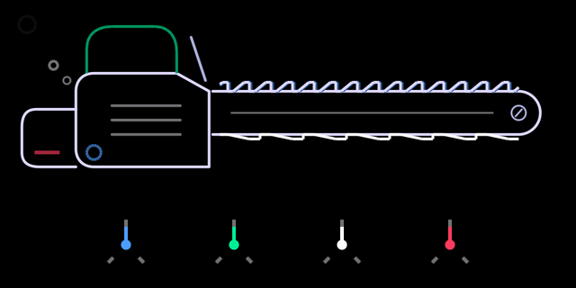
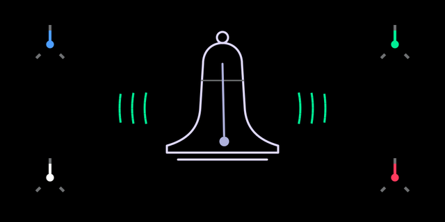
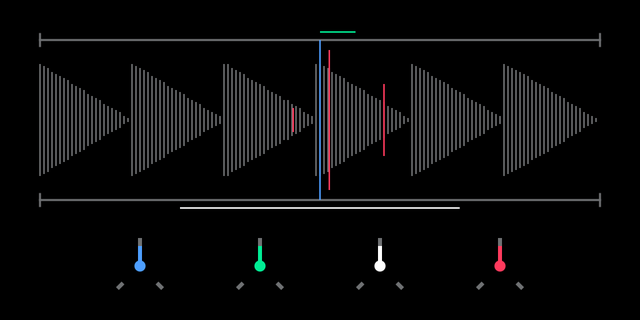
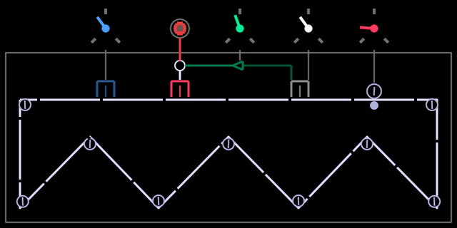
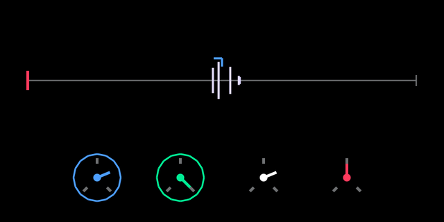
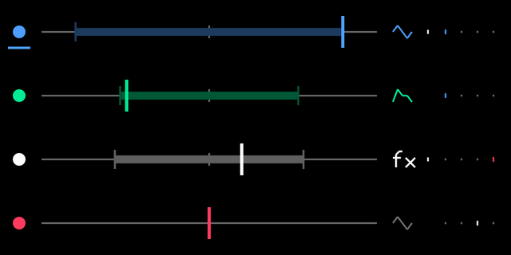
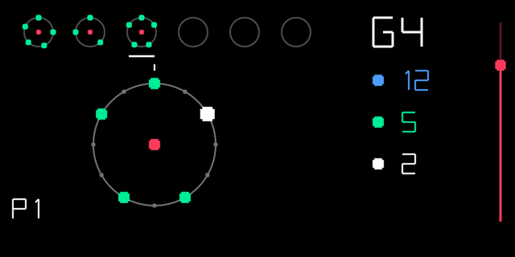

# OP-1 custom firmware patcher (R246)

Turns the original Teenage Engineering OP-1 firmware **R246** (`op1_246.op1`) into a custom firmware
with:

- custom synth engines with their own screens: **supersaw** (chainsaw), **fmbell** (bell), **granular**; they follow note velocity
  - **granular** plays the slot's sample: press **input** on a granular slot for "keyboard to sample" and record
    straight into it (the slot stays granular); **red press** = page 2, sample gain (0–4×)
- animated **lab screen for the stock iter synth**: gauges follow the knobs; bubbles, flame, falling dashes, voice
  dots and a note display react to the knobs and to what you play (graphic: `iter-lab.svg` from
  [op1repacker](https://github.com/op1hacks/op1repacker), MIT License, © 2016 op1hacks)
- boot screen shows `op1r <version>` under the TE logo
- custom FX with their own screens, usable on instruments **and as master FX** (mixer):
  - **tape**: vintage tape echo (time with tape-speed pitch bends, feedback up to self-oscillation, wow &
    flutter, age)
  - **clouds**: granular texture FX, a port of Mutable Instruments Clouds (position, size, pitch, density;
    encoder presses switch to a second page, red press freezes)
  - **reverb**: lush plate/hall reverb, a port of the Mutable Instruments Elements reverb (time, mix, diffusion,
    tone); generic FX screen
- **quad** LFO: four LFOs in one slot, shown as four lanes over the full screen
  - blue frequency (0.05–20 Hz), green amount (bipolar), white target, red destination
  - works on synths and drums; targets: engine knob, envelope (synth ADSR, drum envelope) or FX knob
  - each LFO runs **per voice** (locked to the notes, like the stock LFOs) or **free-running** (white dot next
    to the target)
  - press an encoder to select LFO 1–4
  - hold **Shift** for a table of all four LFOs: blue frequency / tempo division, green smoothing, white waveform
    (sine, triangle, ramp up/down, square, sample & hold), red sync to the OP-1 tempo (4/1 … 1/32, triplets)
- **euclid** sequencer, an extra sequencer next to the stock ones (pick it in the sequencer list), for synth and drums
  - 6 sequencer slots, each playing one note; **Shift + white** selects the slot, a note key on the euclid screen
    assigns its note, at the octave of that moment
  - blue steps, green pulses, white rotation, red start/stop (**Shift + red**: all slots); press an encoder for
    page 2: rate (1/4 … 1/32, triplets), gate, octave, **level** (note velocity, per slot)
  - the level is always shown as a red bar at the right border (triangle next to the dot while red is on page 2);
    a playing slot shows a red dot in the centre of its ring
  - **Shift + G A B C D E** (the last six white keys) mutes/unmutes slots 1–6, **Shift + D#** mutes/unmutes all;
    a muted slot keeps running (dimmed dots) but plays nothing; works from any screen
  - **Shift + C#** starts all slots at once, or stops them if any is running; works from any screen. Hold **REC**
    (tape armed) while starting and the tape starts recording with the first step
  - **4 patterns** per synth/drum: **Shift + F G A B** (the first four white keys) switches to pattern 1–4
    immediately, from any screen (also the tape view). A pattern holds the notes and settings of all slots incl. mutes;
    which slots are playing stays the same across patterns. The pattern number (P1–P4) is shown bottom left
  - on the euclid screen **lift / drop / scissors** copy / paste / cut the selected slot; with **Shift** the whole
    pattern
  - runs at the OP-1 tempo, plays polyphonically and sends MIDI; slot settings and mutes are saved (slots come
    back stopped)
- **MIDI CC control** (USB MIDI, on the OP-1's MIDI channel):
  - keys: CC = key code + 5 as in the OP-1's own CTRL mode, value ≥ 64 press / < 64 release: 5 help, 6 metronome,
    7–10 synth/drum/tape/mixer, 11–14 T1–T4, 15–17 lift/drop/scissors, 21–25 and 50–52 the keys 1–8,
    26 sequencer, 38/39/40 REC/PLAY/STOP, 41/42 left/right, 43 Shift, 48 mic/input, 49 COM
  - encoders: CC 102–105 = blue/green/white/red, relative (1–63 up, 65–127 down); works on every screen
  - mixer: CC 106–109 track 1–4 volume, 110–113 pan (64 = centre), 114–117 mute (≥ 64 = muted); CC 118 tape input
    level
- hidden **OP-Z controller mode** in COM → CTRL, switched on by the SysEx `F0 00 20 76 00 01 03 F7`
  from the host (any MIDI tool that can send SysEx; `F0 00 20 76 00 01 00 F7` switches it off)

## Screens

Rendered on the PC from the same screen code that runs on the OP-1 (host harness in the synth SDK).

| Synth engines | |
|---|---|
|  **supersaw** |  **fmbell** |
|  **granular** |  **iter** (lab screen) |

| Effects | |
|---|---|
|  **tape** echo |  **clouds** |

| LFO | Sequencer |
|---|---|
|  **quad** LFO |  **euclid** sequencer |

The repository contains no Teenage Engineering firmware. You provide the original update file, and the
patcher applies only the differences stored in `data/`. These are our code, our screen SVGs and small
byte edits.

## Usage

Requirements: Python 3.8 or newer, standard library only.

```sh
git clone https://github.com/pcppcp/op1r.git && cd op1r
python3 patch_op1.py /path/to/op1_246.op1            # -> /path/to/op1_246-custom.op1
python3 patch_op1.py /path/to/op1_246.op1 -o op1-custom.op1
python3 patch_op1.py --info                          # what the patch contains + checksums
```

The patcher:
1. Checks the input SHA-256 against the original R246 image and refuses anything else.
2. Unpacks it (CRC-32 → LZMA → tar).
3. Checks every file it touches, both before and after patching (SHA-256 per file).
4. Repacks deterministically: original tar order and metadata, op1repacker's LZMA settings.
5. Checks the result against the reference build's SHA-256.

If only the last step differs while the archive content matched, your Python has a different liblzma
version. The firmware content is still verified identical, and `--accept-recompressed` writes it anyway.

| | SHA-256 |
|---|---|
| input `op1_246.op1` (original R246) | `c5315218f825f143b415ca554516541898abee843d3a236df0b54c04e1fb13a9` |
| output (reference build) | `a3b0b6478dac3398a8fc0bb370aaf41f86e519116c869e63da7e2bd010984758` (also `python3 patch_op1.py --info`) |

Install the result like any OP-1 update (bootloader update mode). The bootloader is not modified, so the
original `op1_246.op1` can always be flashed back. **Use at your own risk.**

Original firmware files (`*.op1`, `*.ldr`, unpacked trees) are git-ignored and must never be committed.

See [CHANGELOG.md](CHANGELOG.md) for what changed between versions.

## Studying the original firmware

[docs/firmware-r246.md](docs/firmware-r246.md) (in French) is a study of the original R246 firmware. It covers:

- the image format, the Blackfin LDR blocks and the memory map;
- the source tree, rebuilt from the assert strings;
- the SQLite registry and how synth engines, FX, LFOs, sequencers, screens, input and MIDI work;
- every edit op1r makes, and how to add features.

Tools (Python 3 standard library):

- `tools/analyze.sh` unpacks, disassembles and indexes the firmware into the git-ignored `work/`. It needs a
  Blackfin objdump: `tools/build_bfin_toolchain.sh --binutils-only`.
- `tools/fwtool.py` is a set of LDR, memory and cross-reference helpers.
- `tools/fwbuild.py` is an experimental image builder. It adds code blocks, CALL/JUMP redirects, table edits,
  files and SQL to the original image. With `--op1r` and no other option, it rebuilds the reference image above
  byte for byte.
- [`examples/midi-panic`](examples/midi-panic) is a small C hook built with `bfin-elf-gcc`: Shift + key sends
  MIDI All Notes Off. It is not flash-tested.
- [`examples/pianoroll`](examples/pianoroll) adds a piano-roll sequencer ("roll") on top of op1r: note editing,
  polyphonic playback, saving, beat-aligned start. Flash-tested.
- [`examples/drive`](examples/drive) adds a Serum-style distortion FX ("drive") on top of op1r and the piano roll:
  13 shaper modes, pre/post filter, mix, level, with a transfer-curve screen. Not flash-tested yet.

## Maintainers: rebuilding the patch data

The patch data is generated from a custom firmware tree built with the synth SDK (`make_firmware.py`,
not part of this repository; needs the Blackfin toolchain):

```sh
python3 <sdk>/synth_sdk/make_firmware.py --opz --release          # builds <sdk>/op1_246_custom/
python3 build_patch.py /path/to/op1_246.op1 <sdk>/op1_246_custom  # regenerates data/ + reference image
```

`build_patch.py` diffs the custom tree against the original image:
- **Changed files** (`OP1_vdk.ldr`, `content/op1_factory.db`): stored as byte edits plus one insertion,
  the new code block.
- **New files** (our SVGs): stored whole.
- **New files identical to a stock file**, such as `fxgeneric.svg` (= `iter.svg`): recorded as `copy_of` and
  recreated from the user's image.

It then runs the patcher once. It writes the reference image (`<custom tree>-patched.op1`, or
`--reference <file>`) and its checksums to `data/manifest.json`, and checks that the reference unpacks to exactly the custom tree.
Flash-test the reference image before publishing a new patch, and commit `data/` together with the
updated output checksum in this README.
